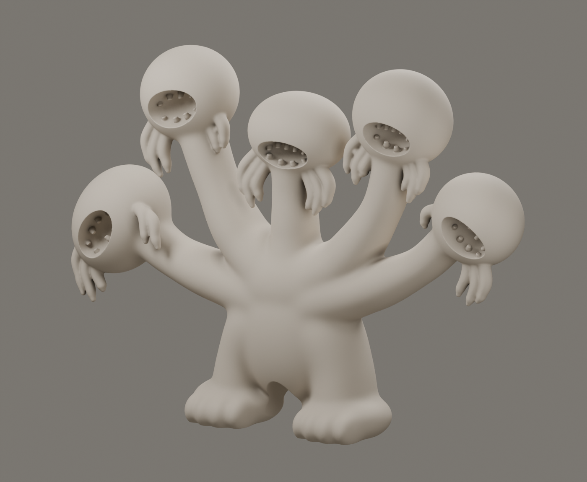

# 3d-monster
it is a gift for my little friend



A five-headed creature modeled in Blender from the supplied reference image,
prepared as one connected solid for filament 3D printing. Final dimensions are **138 mm wide × 30 mm deep × 100 mm high**. And the center of mass is
(-1.053, 1.993, 49.212) with respect to the origin, assuming uniform mass distribution.

## Model files

- **`monster.revised.blend`** — the final editable project, including the packed reference image.
- **`monster_138x30x100mm.stl`** — the exported print mesh, with coordinates in millimeters.
- `references/monster-reference.png` — original visual reference.
- `monster_*.png` — front, back, three-quarter, mouth, hair, and hip previews.

## Download

The Blender and STL files use **Git LFS**. Install Git LFS before cloning:

```sh
git lfs install
git clone https://github.com/zekicanozkanli/3d-monster.git
cd 3d-monster
git lfs pull
```

## Printing

Import the STL into the slicer for your printer. Confirm the imported size is
138 × 30 × 100 mm, select the correct printer, nozzle, and filament profile,
and configure supports for the overhangs. Inspect the layer preview carefully,
especially the teeth, hair tips, and hanging features, before exporting the
printer-specific print file. Printer, nozzle size, and filament material have
not yet been specified.

Recorded mesh checks report one connected component, zero non-manifold edges,
zero degenerate faces, Euler characteristic 2, and 2,985,834 triangles. See
`verification.json`, `mesh_report.json`, `hair_voids_after.json`, and
`stl_export_report.json`. Geometry checks do not replace slicer inspection.

## Blender scripts

The project was created with Blender 5.4.0 Alpha. Run these commands from the
repository directory with Blender available as `blender`:

```sh
# Verify the saved final project without modifying it.
blender --background monster.revised.blend --python verify_monster.py

# Re-export and verify the STL dimensions.
blender --background monster.revised.blend --python export_print_stl.py

# Check the repaired hair regions.
blender --background monster.revised.blend --python scan_hair_voids.py
```

`build_monster.py` contains the procedural modeling source and writes
`monster.prepared.blend` plus renders. `monster_reference.py` contains the traced
landmarks and print dimensions. To rebuild, run
`blender --background --factory-startup --python build_monster.py`, then
`blender --background monster.prepared.blend --python finalize_monster.py` to
pack the reference. Rebuilding can take time and overwrites generated previews.

`render_revision_details.py` renders close-ups. `merge_with_current_scene.py`
preserves a loaded scene's materials while replacing its mesh from the prepared
file. `repair_and_present.py` is a utility for a diagnostic build. Local backups,
duplicate prepared files, logs, caches, and historical comparison files are
excluded from version control.
